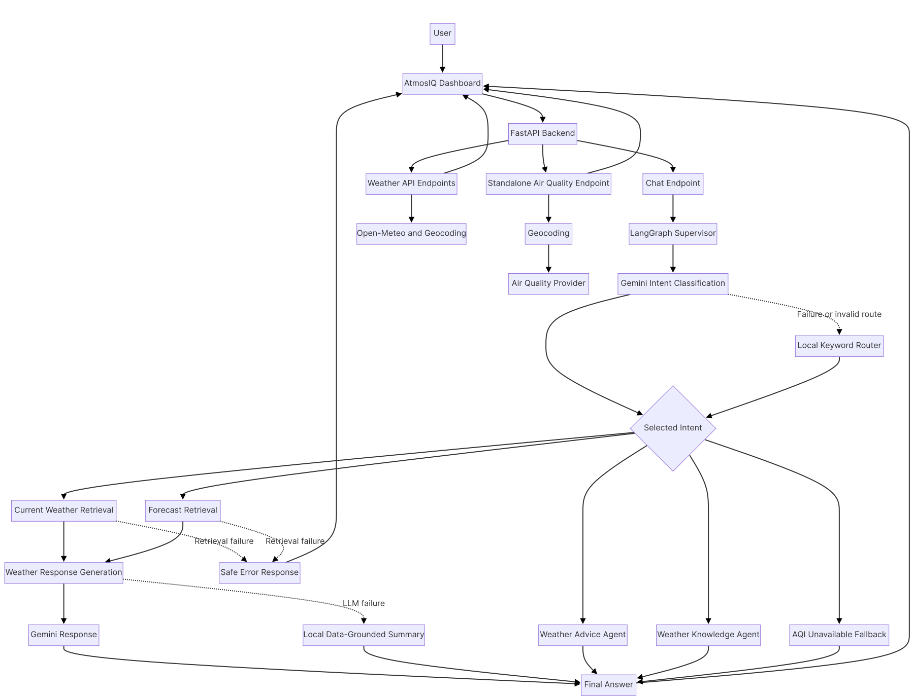

# AtmosIQ — Weather Intelligence Assistant

AtmosIQ is a weather dashboard and conversational assistant built with Python, Streamlit, FastAPI, and LangGraph. It retrieves live weather data from Open-Meteo and presents current conditions, forecasts, and weather-related answers.

## Features

- Current weather conditions and practical advice
- 24-hour hourly forecast with a temperature trend chart
- Seven-day daily forecast
- Conversational weather questions and recommendations
- Supervisor-based intent routing and specialist agents
- Local fallback routing and summaries when Gemini is unavailable
- India-specific AQI calculation utilities
- Automated backend tests with pytest

## Architecture





```text
User
 |
 v
Streamlit Dashboard
 frontend/app.py
 |
 | HTTP
 v
FastAPI Backend
 backend/app/main.py
 |
 +--> Weather API
 |     +--> Geocoding
 |     +--> Current conditions
 |     +--> Hourly forecast
 |     +--> Daily forecast
 |
 +--> Air Quality API
 |     +--> Geocoding
 |     +--> Current air quality readings
 |
 +--> LangGraph Weather Workflow
 |     +--> Supervisor / intent routing (Gemini + Local Keyword Fallback)
 |     +--> Current weather retrieval
 |     +--> Forecast retrieval
 |     +--> Weather advice specialist
 |     +--> Weather knowledge specialist
 |     +--> Air-quality specialist (Live Open-Meteo Air Quality)
 |
 v
Open-Meteo weather & air-quality services
```

## Project structure

```text
AtmosIQ/
├── .venv/
├── frontend/
│   └── app.py
├── backend/
│   ├── app/
│   │   ├── main.py
│   │   ├── api/
│   │   ├── agents/
│   │   ├── services/
│   │   └── tools/
│   └── tests/
└── README.md
```

## Requirements

- Python 3.13 or a compatible Python version
- Internet access for live weather data
- A Python virtual environment
- Gemini API credentials and available quota if Gemini-powered responses are enabled

Tested locally with Python 3.13.11, Streamlit 1.65.0, and Pandas 3.0.6.

## Setup

Open PowerShell in the project root.

### 1. Activate the virtual environment

If `.venv` already exists:

```powershell
.\.venv\Scripts\Activate.ps1
```

If you need to create it:

```powershell
py -3.13 -m venv .venv
.\.venv\Scripts\Activate.ps1
```

### 2. Install dependencies

Install the packages used by the application:

```powershell
python -m pip install --upgrade pip
python -m pip install fastapi "uvicorn[standard]" streamlit pandas httpx pydantic pydantic-settings python-dotenv langgraph langchain-google-genai pytest
```

Keep any additional dependencies already required by your existing project environment.

### 3. Configure environment variables

Copy `backend/.env.example` to `backend/.env`:

```powershell
cp backend/.env.example backend/.env
```

Key configuration options in `backend/.env`:
- `GEMINI_API_KEY`: Google Gemini API key (required if `ATMOSIQ_USE_GEMINI=true`).
- `ATMOSIQ_USE_GEMINI`: Set to `false` (default) to run completely offline using deterministic keyword routing and local advice fallbacks.
- `ATMOSIQ_GEMINI_MODEL`: Gemini model identifier (defaults to `gemini-1.5-flash`).
- `ATMOSIQ_LOCAL_ROUTING`: Set to `1` to bypass LLM supervisor classification and use local keyword routing.
- `ATMOSIQ_CORS_ORIGINS`: Comma-separated list of allowed origins for web clients.

Never commit your actual `.env` file containing secrets to version control.

## Run AtmosIQ

Start the backend and frontend in two separate PowerShell terminals.

### Terminal 1 — Backend

```powershell
cd "C:\Users\Lenovo\Desktop\my personal Projects\AtmosIQ"
.\.venv\Scripts\Activate.ps1
cd .\backend
python -m uvicorn app.main:app --reload --host 127.0.0.1 --port 8000
```

Backend URL: http://127.0.0.1:8000

API documentation: http://127.0.0.1:8000/docs

### Terminal 2 — Frontend

```powershell
cd "C:\Users\Lenovo\Desktop\my personal Projects\AtmosIQ"
.\.venv\Scripts\Activate.ps1
python -m streamlit run .\frontend\app.py
```

Dashboard URL: http://localhost:8501

Keep both terminals running while using the application.

## API endpoints

| Method | Endpoint | Description |
|---|---|---|
| GET | `/` | Backend status response |
| GET | `/health` | Health check |
| GET | `/api/v1/weather?city=Mumbai` | Current weather conditions and advice |
| GET | `/api/v1/weather/hourly?city=Mumbai&hours=24` | Hourly forecast |
| GET | `/api/v1/weather/daily?city=Mumbai&days=7` | Daily forecast |
| GET | `/api/v1/air-quality?city=Mumbai` | Current air quality (US/EU AQI, PM2.5, PM10) |
| POST | `/api/v1/chat` | Conversational weather assistant |

### Chat request example

Send a POST request to `/api/v1/chat`:

```json
{
  "message": "Will it rain in Mumbai tomorrow?",
  "city": "Mumbai"
}
```

The response contains the resolved city, a text answer, and the weather data used by the assistant.

Both `message` and `city` are required.

## Testing

Run the backend test suite:

```powershell
cd "C:\Users\Lenovo\Desktop\my personal Projects\AtmosIQ\backend"
python -m pytest -v
```

Check frontend syntax:

```powershell
cd "C:\Users\Lenovo\Desktop\my personal Projects\AtmosIQ"
python -m py_compile .\frontend\app.py
```

The current backend test baseline is **91 passing tests and 1 skipped test** (isolated ML dependency test). Run the suite again after making code changes.

## Current limitations

- Gemini-powered responses depend on valid credentials and available API quota. When quota is unavailable or disabled (`ATMOSIQ_USE_GEMINI=false`), deterministic local keyword routing and rule-based advice fallbacks are used.
- Live weather and air-quality data depend on internet access and Open-Meteo public APIs.
- Air-quality readings (US AQI, PM2.5, PM10) are retrieved via the Open-Meteo Air Quality API. Indian CPCB sub-index calculation utilities are supported offline in `app.services.india_aqi`, but live official government CPCB sensor stations are not directly integrated.
- The project has been tested locally on Windows; production deployment, containerization, and rate limiting represent future roadmap enhancements.

## Data and responsible use

AtmosIQ uses Open-Meteo for weather and air-quality data. Forecasts are estimates and can change. Rain probability describes the likelihood of precipitation, not a guarantee.

## Development status

The dashboard, current conditions, hourly temperature chart, daily forecast, air-quality endpoint, chat flow, and backend tests have been exercised locally.

The next priorities are regression testing, response quality, configuration management, and deployment readiness.